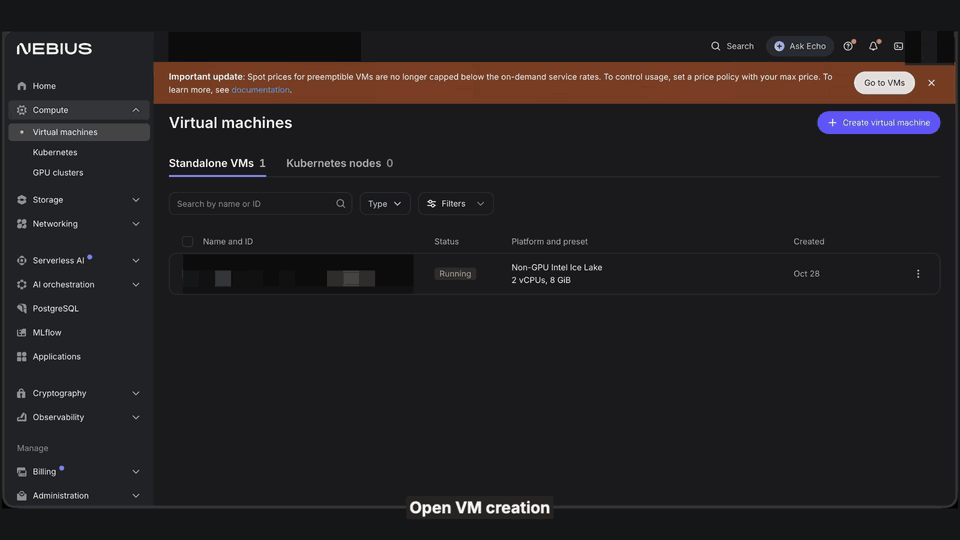
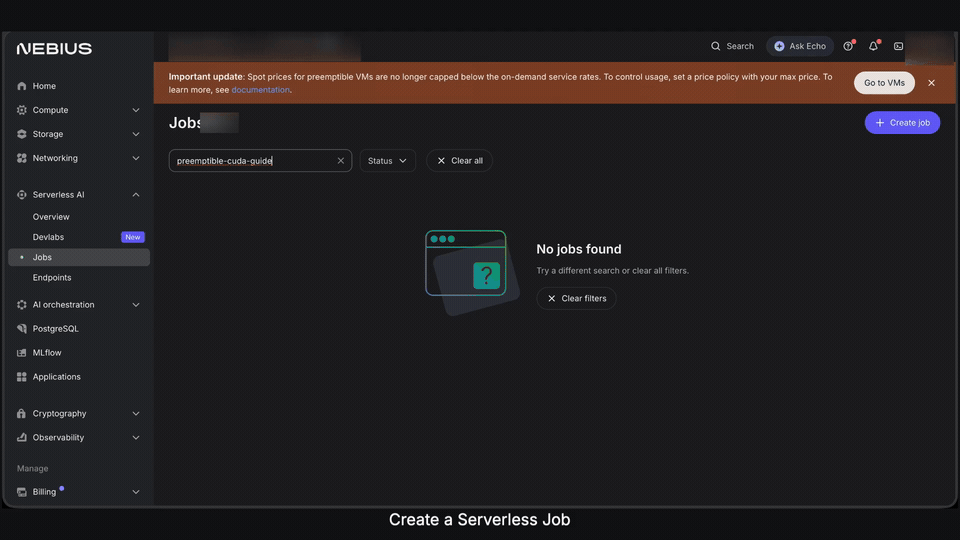
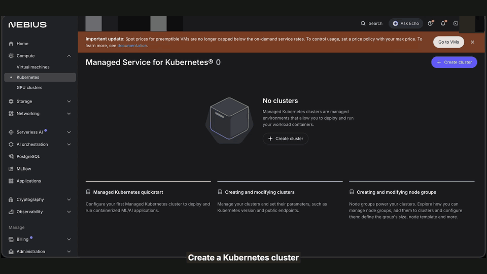

# Get Started with Nebius Preemptible GPUs

Run the same small CUDA check three ways: on a **GPU VM**, as a **Serverless Job**, and on a **Kubernetes GPU worker**. This cookbook keeps the setup, commands, recordings and cleanup in one place.

Preemptible GPUs use spare capacity at a spot price that can be much lower than on demand. Nebius can reclaim them when capacity is needed or the price exceeds your limit. In this walkthrough, the H100 quote was **$0.80/hour versus $4.50/hour on-demand**, before disk and tax. Prices change.

Each path adds **4,096 pairs of numbers on the GPU** and checks every answer:

```json
{"device":"NVIDIA H100 80GB HBM3","elements":4096,"pass":true}
```

## Common setup

- Use a billing-enabled **eu-north1** project with permission and quota for one preemptible H100, plus an existing internet-enabled subnet.
- Locally, have Git and Bash. The VM path also uses OpenSSH/Python 3; Kubernetes uses the Nebius CLI and kubectl 1.36.
- Run one path at a time, or follow them in order. Save outputs before removing resources.

Get the files:

```bash
git clone https://github.com/MarouaneKhoukh/nebius-preemptible-guide.git
cd nebius-preemptible-guide
```

In the [console](https://console.nebius.com), select your project. Under **Billing → Pricing → Pricing policy**, create one H100 policy named, for example, `gpuguide`, with **$1.50 per GPU-hour** as its maximum in USD. Use that policy in every path and keep it until the final cleanup. You can also create it from a resource's **Max price** field.

You pay the current spot price, not automatically the maximum. The policy is neither a total budget nor a capacity guarantee; disks are charged separately. Record each new resource for cleanup.

## Path 1: GPU VM

Use a VM when you want SSH access and control of the operating system.



[Download the VM console recording](vm/media/console-walkthrough-share.mp4).

### Create and connect

Prepare a dedicated SSH key locally. Choose another filename if it exists:

```bash
mkdir -p "$HOME/.ssh"
chmod 700 "$HOME/.ssh"
ssh-keygen -t ed25519 -f "$HOME/.ssh/nebius-gpu-guide" -C nebius-gpu-guide
cat "$HOME/.ssh/nebius-gpu-guide.pub"
```

Set a passphrase. Copy only the `.pub` contents; keep the private key locally.

Open **Compute → Virtual machines → Create virtual machine**. If General appears, select **Pay-as-you-go VM**.

- **Compute:** name `preemptible-gpu-guide`; **Preemptible → With GPUs → H100, 16 vCPU, 200 GiB**. Select your shared policy under **Max price**.
- **Storage:** edit the boot disk; select **New VM-managed disk → Public image → Ubuntu 24.04 LTS for NVIDIA GPUs (CUDA 13)**, **SSD**, **50 GiB**.
- **Network:** reuse your subnet; **Public IP → Auto**.
- **Configuration:** under **Username and SSH key**, select **Create**. Enter username `cookbook`, your public key and a unique credentials name, then **Add credentials**. Avoid reserved usernames `root`/`admin`.
- **Review:** check the quote and create the VM. Wait for **Running**.

In VM details, open **Serial logs**, keep the default selector and add `|= "SHA256:"`. Compare the ED25519 fingerprint with the first SCP/SSH prompt before accepting.

Replace the IP and run locally:

```bash
export VM_IP="YOUR_VM_PUBLIC_IP"
scp -i "$HOME/.ssh/nebius-gpu-guide" \
  vm/examples/minimal-gpu-check.sh vm/examples/vector-add.cu \
  "cookbook@$VM_IP:./"
ssh -i "$HOME/.ssh/nebius-gpu-guide" "cookbook@$VM_IP"
```

Inside the VM:

```bash
bash minimal-gpu-check.sh gpu-check-results
exit
```

Look for **`pass: true`**. Download before stopping:

```bash
scp -i "$HOME/.ssh/nebius-gpu-guide" -r \
  "cookbook@$VM_IP:./gpu-check-results" ./gpu-check-results
```

### Verify persistence and remove the VM

Stop the VM and wait for **Stopped**, then start the same VM. If capacity blocks restart, keep your download and continue to cleanup. Its public IP can change:

```bash
export VM_IP="YOUR_CURRENT_VM_PUBLIC_IP"
ssh -i "$HOME/.ssh/nebius-gpu-guide" "cookbook@$VM_IP"
```

Inside the VM, check the original result without rerunning CUDA:

```bash
cd gpu-check-results
python3 - <<'PYCODE'
import hashlib
from pathlib import Path
expected = Path("result.sha256").read_text().strip()
actual = hashlib.sha256(Path("result.json").read_bytes()).hexdigest()
assert actual == expected, "The saved result changed"
print("Saved CUDA result survived stop/start.")
PYCODE
```

The network SSD survives stop/start; memory and local SSD do not. A longer workload needs its own checkpoint/resume logic.

After downloading, open **Settings → Danger zone → Delete virtual machine**. Type its name and choose **Delete VM and disks**. Check for remaining disks/IP allocations created for this VM. Keep the shared pricing policy if continuing.

## Path 2: Serverless Job

Use a Job for a container that runs and finishes, without configuring SSH or maintaining its VM.



[Download the Serverless Job console recording](jobs/media/console-walkthrough-share.mp4).

Open **Serverless AI → Jobs → Create job** and configure a custom container:

- **Image:** paste this pinned NVIDIA CUDA devel image:

```text
docker.io/nvidia/cuda@sha256:0eee3094c71518ad31d011a594ae6ed6de72959ee07e318cb31cffe71690e90c
```

- **Compute:** one **H100**, **16 vCPU / 200 GiB**, **Preemptible**, and your shared **$1.50/GPU-hour policy**.
- **Timeout:** **1 hour**. **Container disk:** **100 GiB**. Reuse your subnet; leave SSH unselected.
- **Files:** upload `jobs/run-vector-add.sh` to **`/recipe/run-vector-add.sh`** and `vm/examples/vector-add.cu` to **`/recipe/vector-add.cu`**.
- **Entrypoint:** use the shell editor with:

```sh
#!sh
bash /recipe/run-vector-add.sh
```

Create the Job once and open its logs. The worker compiles CUDA and prints the JSON followed by its SHA-256. Wait for **Completed**, then use **Export logs** to save them locally before deleting the Job record. Container files disappear when the Job finishes; this tiny check uses saved logs as its output.

A completed Job releases its GPU. After preemption, rerun with the same files only once the original Job reaches a terminal state, such as Failed or Cancelled; never launch a duplicate while it is active. Cancel an active Job if you stop the experiment; a terminal wait timeout does not cancel it. Keep the policy for the next path.

Optional CLI validation: with your CLI profile configured, export `NEBIUS_PROJECT_ID`, `NEBIUS_SUBNET_ID` and `NEBIUS_PRICING_POLICY_ID`, then run `bash jobs/dry-run.sh`. It validates the same capped request and never creates a resource.

## Path 3: Kubernetes GPU worker

Use this path when you want Kubernetes to schedule your GPU containers. The control plane alone does not run this check: add one preemptible GPU worker.



[Download the Kubernetes console recording](kubernetes/media/console-walkthrough-share.mp4).

### Create the cluster and worker

In **Managed Kubernetes**, create a cluster named `preemptible-gpu-guide` in the same project/subnet with **Kubernetes 1.36**. Keep the default control-plane availability settings, leave Karpenter disabled and enable the public endpoint restricted to **your current IPv4 address /32**. At Review, create **without node groups or applications** and confirm creation without nodes; add the single worker below afterward. Avoid a default three-node group.

Add one node group:

- **General:** choose **Pay-as-you-go VM**, name `preemptible-h100-guide`, reuse your subnet/security group, and leave **Public IPv4 off**. This run used existing private internet egress.
- **Compute:** **With GPUs → Preemptible → H100 NVLink**, **Number of nodes: 1**, **1 GPU / 16 CPU / 200 GiB**, and the shared policy.
- **Drivers:** **Install NVIDIA drivers on**, **CUDA 13.0 / Driver 580**, **Ubuntu 24.04**.
- **Storage:** **SSD, 100 GiB**.
- **Additional:** clear any automatically selected SSH credential to **Not selected**; leave the service account unselected.
- **Review:** confirm one GPU and create the node group.

Wait for the worker to be **Ready** and expose **`nvidia.com/gpu: 1`**. No separate CPU group is needed.

### Connect and run

Use the [Nebius CLI](https://docs.nebius.com/cli/install) and [kubectl 1.36](https://kubernetes.io/docs/tasks/tools/). Configure the CLI for this project; if needed, choose an unused profile name (here `gpu-guide`) and complete browser sign-in:

```bash
export AI_AGENT="${AI_AGENT:-cookbook}"
export NEBIUS_PROJECT_ID="YOUR_PROJECT_ID"
nebius profile create gpu-guide --parent-id "$NEBIUS_PROJECT_ID" &&
nebius profile activate gpu-guide &&
nebius iam whoami
```

Copy the cluster ID from its console page. Create a fresh private kubeconfig:

```bash
mkdir -p .state
kube_dir="$(mktemp -d "$PWD/.state/kubeconfig.XXXXXX")"
export KUBECONFIG="$kube_dir/config"
unset KUBE_CONTEXT
nebius mk8s cluster get-credentials \
  --id "YOUR_CLUSTER_ID" --external --kubeconfig "$KUBECONFIG" &&
KUBE_CONTEXT="$(kubectl config current-context)" &&
export KUBE_CONTEXT &&
kubectl --context "$KUBE_CONTEXT" config view --minify
```

Check that the displayed server belongs to your new cluster before continuing. If credentials failed, stop and fix authentication/connectivity. The endpoint allowlist must match your network egress; a VPN can route cluster traffic differently. Then check the worker:

```bash
kubectl --context "${KUBE_CONTEXT:?Connect to the new cluster first}" get nodes
kubectl --context "$KUBE_CONTEXT" get nodes \
  -o custom-columns='NAME:.metadata.name,GPU:.status.allocatable.nvidia\.com/gpu'
```

Use a fresh `gpu-guide` namespace; stop if it already exists. Upload the same source and submit the Kubernetes Job:

```bash
kubectl --context "${KUBE_CONTEXT:?Connect to the new cluster first}" create namespace gpu-guide &&
kubectl --context "$KUBE_CONTEXT" --namespace gpu-guide create configmap gpu-check-source \
  --from-file=run-vector-add.sh=jobs/run-vector-add.sh \
  --from-file=vector-add.cu=vm/examples/vector-add.cu &&
kubectl --context "$KUBE_CONTEXT" apply -f kubernetes/gpu-check.yaml &&
kubectl --context "$KUBE_CONTEXT" --namespace gpu-guide wait \
  --for=condition=complete job/gpu-check --timeout=900s &&
mkdir -p kubernetes/.state &&
SUCCESS_POD="$(kubectl --context "$KUBE_CONTEXT" --namespace gpu-guide get pods \
  -l job-name=gpu-check --field-selector=status.phase=Succeeded \
  -o jsonpath='{.items[0].metadata.name}')" &&
test -n "$SUCCESS_POD" &&
kubectl --context "$KUBE_CONTEXT" --namespace gpu-guide logs \
  "$SUCCESS_POD" --container cuda-check > kubernetes/.state/gpu-check.log &&
cat kubernetes/.state/gpu-check.log
```

The manifest requests one GPU, one CPU and 2 GiB RAM, allows one retry and sets a 15-minute deadline. A retry starts this small calculation again; it does not restore a checkpoint. If waiting fails, inspect the Pod/events rather than blindly creating another Job.

### Remove the Kubernetes resources

After saving logs:

```bash
kubectl --context "$KUBE_CONTEXT" delete namespace gpu-guide
```

Completing a Kubernetes Job does **not** stop its GPU worker. Copy only the ID of the **new, dedicated cluster** created for this walkthrough:

```bash
export CLUSTER_ID="YOUR_NEW_TEST_CLUSTER_ID"
nebius mk8s cluster delete --id "$CLUSTER_ID" --async
nebius mk8s cluster get --id "$CLUSTER_ID"
```

Repeat `get` until **NotFound**. Cluster deletion also removes its managed node group; verify the worker VM, boot disk and IP allocations were removed. Preserve reused networks.

## Final cleanup and validation

After your last path, wait for resources to finish deleting, then delete the shared policy under **Billing → Pricing → Pricing policy**. Remove dedicated local SSH keys/kubeconfigs you won't reuse. Stopping alone leaves disk charges; none of these examples sets a total spending budget.

- **VM:** console provisioning, SSH CUDA check and CLI cleanup tested. Stop/start changed the boot ID and preserved the original checksum. [Verification](vm/results/verification.json).
- **Serverless Job:** **Completed**, 4,096 results passed, same checksum as the VM; logs saved and Job deleted. [Verification](jobs/results/verification.json).
- **Kubernetes:** the private H100 worker exposed one GPU; the Job completed with exit code 0, 4,096 results passed and the same checksum. Namespace and cluster resources removed; CLI cleanup verified. [Verification](kubernetes/results/verification.json).

All cloud resources created for these tests were removed; existing resources were preserved. Natural preemption was not deliberately triggered.

The recordings show actual console operations. CUDA ran over SSH for the VM. The Kubernetes film ends with the Running worker; its workload and cleanup were verified separately with kubectl and the Nebius CLI. The VM cleanup recording labels its CLI deletion accurately.

## Prefer an agent?

Install the [Nebius skills](https://github.com/nebius/skills#install) with a configured CLI profile, or connect the operational [Nebius MCP](https://docs.nebius.com/ai-agents/mcp-server).

```text
Follow this cookbook in my selected project. Use the Nebius compute,
Serverless Jobs and Kubernetes tools for the path I choose. Show GPU,
disk and pricing settings before launch. Reuse existing networking.
Run the CUDA check, save its output and delete every resource created
for the test. Keep the shared policy until the last path is finished.
```

Sources: [preemptible VMs](https://docs.nebius.com/compute/virtual-machines/preemptible), [pricing policies](https://docs.nebius.com/signup-billing/manage-pricing-policy), [Serverless Jobs](https://docs.nebius.com/serverless/jobs/manage), [GPU nodes](https://docs.nebius.com/kubernetes/gpu/set-up).
